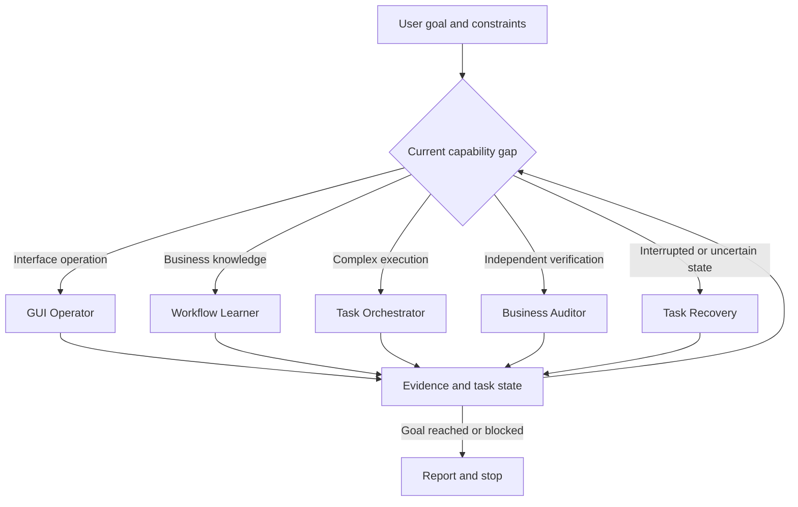

# LegacyBridge

**Make existing software AI-operable, without rewriting it.**

LegacyBridge is a decision-driven skill framework for AI agents operating existing desktop and web software through authorized graphical interfaces. It is a collection of behavioral instructions, not a standalone automation engine.

## Why decision-driven skills?
A common architectural mistake is to divide skills by what AI can do rather than by how AI decides what capability it needs. LegacyBridge designs each skill around a distinct decision boundary. Skills can be used independently, combined on demand, revisited or skipped. There is no mandatory pipeline.

## Skills
| Skill | Decision boundary |
|---|---|
| [GUI Operator](skills/legacy-gui-operator/SKILL.md) | How do I operate this interface? |
| [Workflow Learner](skills/legacy-workflow-learner/SKILL.md) | What business rules do I need? |
| [Task Orchestrator](skills/legacy-task-orchestrator/SKILL.md) | How do I deliver this complex outcome? |
| [Business Auditor](skills/legacy-business-auditor/SKILL.md) | Is the actual business state correct? |
| [Task Recovery](skills/legacy-task-recovery/SKILL.md) | How can I safely resume? |

## Quick start
1. Use an agent environment with authorized GUI tools and a way to load skill instructions.
2. Copy the desired skill directories into the host's supported skill location, or load their Markdown instructions manually. Host-specific installation and automatic routing are not guaranteed.
3. Optionally load [agent guidance](agents/AGENT.md). Start with synthetic data and a read-only task.
4. Try the [examples](examples/README.md). For write tasks, explicitly authorize the target and scope.

## Applications
Potential applications include CRM and ERP migration, HR record reconciliation, finance data checks, education administration, repetitive data entry and interrupted business workflows. These are application candidates, not claims of production deployments.

## Evidence
An internal synthetic CRM experiment recorded 31 minutes for the first successful migration (including debugging and human guidance), and 8 minutes for the second. The observed elapsed-time reduction was approximately 74.2%; this is not a controlled benchmark or a comparison with manual labor. See [experiment notes](benchmarks/results.md).

## Documentation
- [Architecture and design](docs/architecture.md)
- [Installation and compatibility](docs/installation.md)
- [Safety and data handling](docs/security.md)
- [Environment observations](docs/environment-notes.md)
- [Demo status](demos/README.md)

## Status
Research prototype. The five skill instructions are included. Host integration, full-batch performance and independent audit/recovery require further validation. Original demo source and raw execution logs are not included.

## License
Proposed MIT licensing; see LICENSE. The repository owner must confirm ownership and permission before public release.
